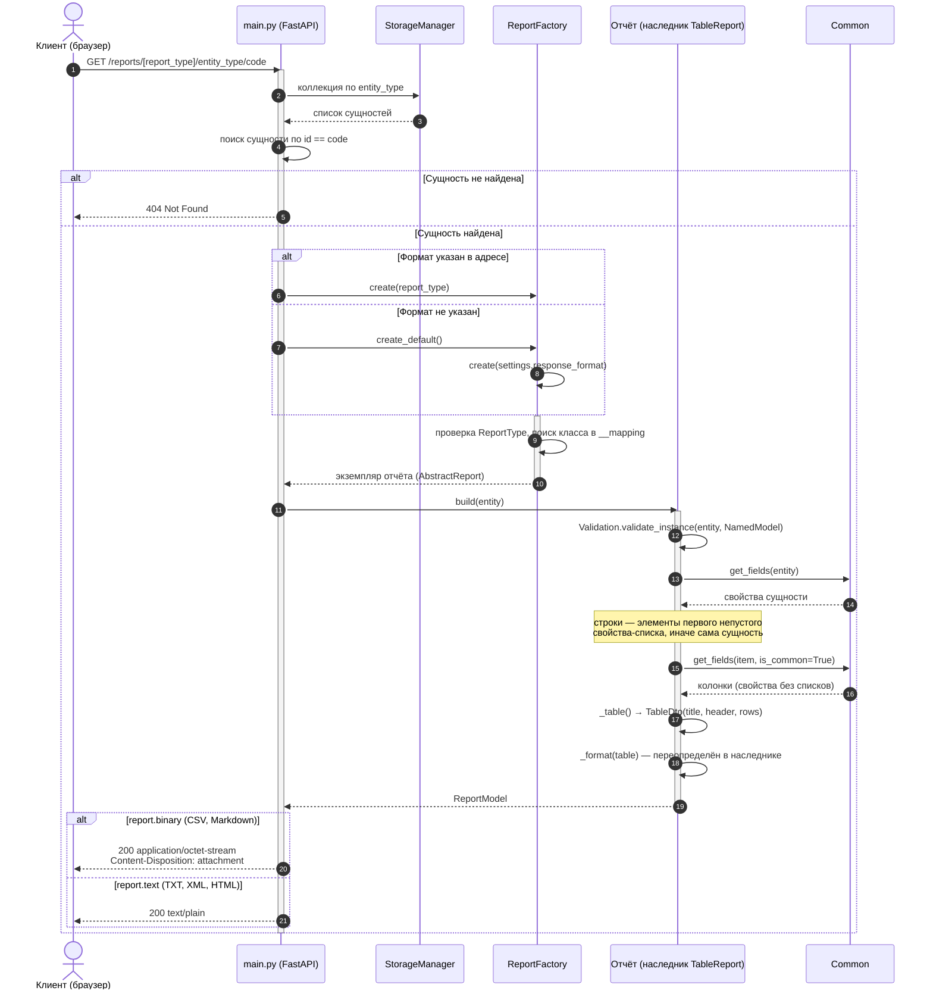

# UML: Абстрактная фабрика

Фабрика отчётов `ReportFactory` реализует контракт `AbstractFactory`: по типу отчёта (`ReportType`)
создаёт построитель — наследника `TableReport`. Фабрика хранит настройки, поэтому `create_default()`
создаёт построитель формата из `settings.response_format`. Клиентский код (`main.py`) знает только
`create()` / `create_default()` и `build()`, конкретный класс отчёта ему неизвестен.

Построитель собирает таблицу рефлексией (`Common.get_fields`) в `TableDto`, а оформление делегирует
наследнику через `_format()` (шаблонный метод). CSV и Markdown возвращают байты — они уходят клиенту
файлом, TXT, XML и HTML — текстом.

## Диаграмма последовательности: формирование отчёта

