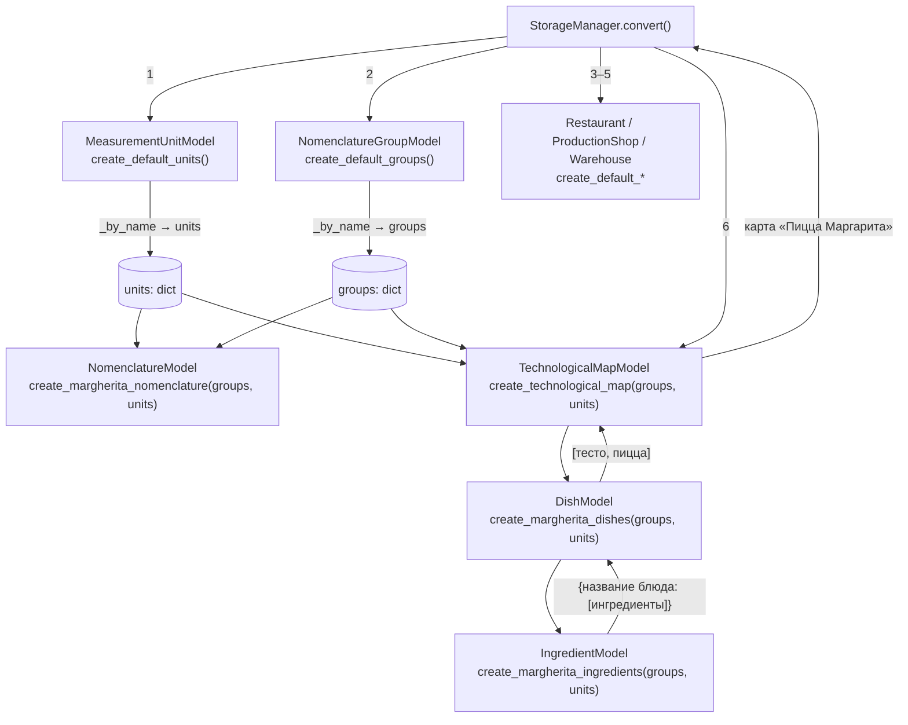
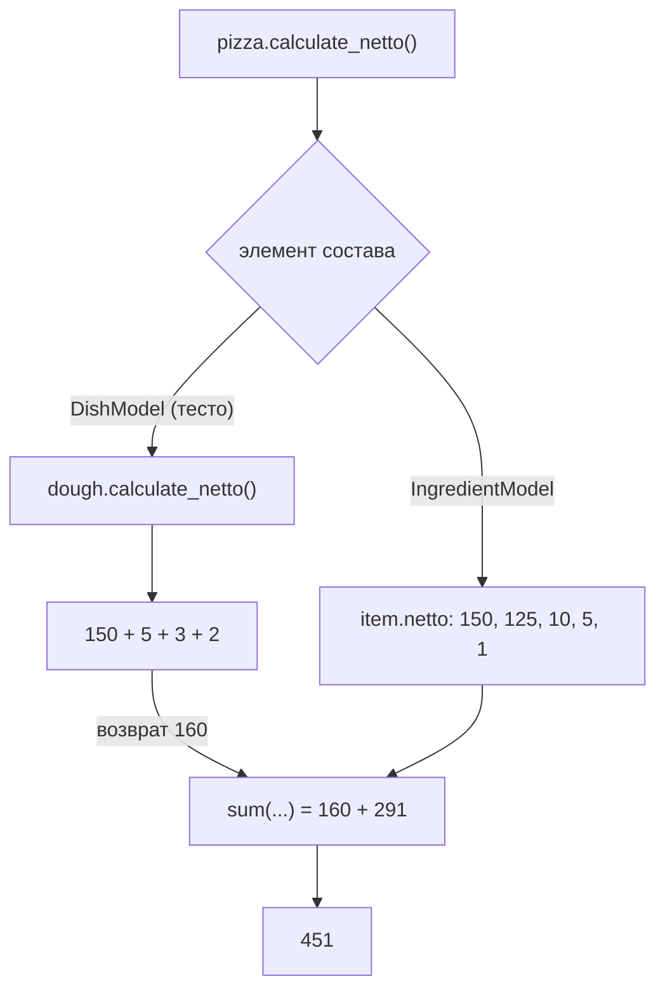

# Обзор изменений ветки: как всё работает

Сводка по ветке `add_technological_map`: что добавлено и как части связаны между собой.
Диаграммы классов и последовательностей — в [recipes.md](recipes.md) и [storage_manager.md](storage_manager.md),
здесь — картина «во время работы»: откуда берутся объекты, на что они ссылаются и как считается вес.

## Что изменилось

| Область | Изменение |
| --- | --- |
| `IngredientModel` | Номенклатура + вес брутто и нетто (положительные числа). Фабрика `create_margherita_ingredients` |
| `DishModel` | Непустой состав из ингредиентов и вложенных блюд + рецепт. `calculate_netto()` / `calculate_brutto()` рекурсивны. Фабрика `create_margherita_dishes` |
| `TechnologicalMapModel` | Список блюд (может быть пустым), `add_dish()`. Фабрика `create_technological_map` |
| Остальные модели | Фабрики `create_default_*` вынесены из `StorageManager` в сами модели |
| `StorageManager` | `convert()` стал короче: вызывает фабрики и превращает списки в словари через `_by_name()`. Новая коллекция `technological_maps` |
| Тесты, диаграммы | Тесты на новые модели и фабрики, UML рецептов, обновлён UML хранилища |

## Принцип: фабрики моделей, словари от хранилища

Каждая модель сама умеет создавать свои данные по умолчанию. Но единицы измерения и группы
фабрика ингредиентов **не создаёт**, а получает готовые словари `groups` и `units` из `StorageManager`.
Поэтому у ингредиентов, номенклатуры и складов ссылки ведут на одни и те же объекты, без копий
(это проверяют тесты хранилища через `is`).



## Объекты после запуска

Тесто — **один и тот же объект**: он лежит и в `dishes` карты, и в составе пиццы.
Поэтому изменение ингредиента теста меняет вес и теста, и пиццы.

```mermaid
flowchart LR
    MAP["TechnologicalMapModel<br/>«Пицца Маргарита»"]
    DOUGH(["DishModel<br/>«Тесто для пиццы»"])
    PIZZA(["DishModel<br/>«Пицца Маргарита»"])

    MAP -->|dishes\[0\]| DOUGH
    MAP -->|dishes\[1\]| PIZZA
    PIZZA -->|"ingredients\[0\] (то же тесто)"| DOUGH

    DOUGH --> d1["Мука 150"]
    DOUGH --> d2["Масло 5"]
    DOUGH --> d3["Соль 3"]
    DOUGH --> d4["Дрожжи 2"]

    PIZZA --> p1["Томаты 150"]
    PIZZA --> p2["Моцарелла 125"]
    PIZZA --> p3["Масло 10"]
    PIZZA --> p4["Базилик 5"]
    PIZZA --> p5["Соль 1"]
```

Вес в граммах (в фабрике брутто = нетто): тесто `150+5+3+2 = 160`, пицца `160 + (150+125+10+5+1) = 451`.

## Рекурсия `calculate_netto()` / `calculate_brutto()`

Это шаблон «Компоновщик»: ингредиент — лист, блюдо — узел. Блюдо суммирует свой состав и для каждого
вложенного блюда вызывает тот же метод. Лист возвращает свой `netto` (или `brutto`) и рекурсию завершает.



Вес считается заново при каждом вызове, ничего не кэшируется: после замены ингредиента (например,
`dough.ingredients[0].brutto = 200`) результат меняется сразу.

## Защита состояния

- Все поля проходят через `Validation` в сеттерах: типы, непустые строки, положительные числа (`bool` не число).
- `ingredients` и `dishes` отдают **копии** списков, а сеттер копирует входной список, поэтому внешний код
  не меняет состав в обход проверок. Добавить блюдо в карту можно только через `add_dish()`.
- Состав `DishModel` не может быть пустым; в карте блюда допустимы только `DishModel`.
- `StorageManager` — singleton, повторный `start()` данные не пересоздаёт.

## Известные ограничения

- **Циклы не отслеживаются.** Если блюдо включить в собственный состав (прямо или через вложенное),
  `calculate_*` уйдёт в бесконечную рекурсию (`RecursionError`).
- **Ингредиент не связан с номенклатурой.** `IngredientModel` — отдельный объект: он повторяет имя, группу
  и единицу измерения, но не ссылается на позицию из `StorageManager.nomenclature`. Из-за этого, например,
  мука в номенклатуре в килограммах, а в ингредиентах — в граммах. Тесты проверяют только то, что группы и единицы
  ингредиентов взяты из хранилища.
- **Единицы не приводятся.** Вес суммируется как числа; если смешать граммы и килограммы или миллилитры
  (масло оливковое считается в мл и складывается с граммами), сумма «граммов» окажется условной.
- Вода из рецепта в состав не входит (нет в номенклатуре), поэтому вес теста 160 г, а не ~250 г.
